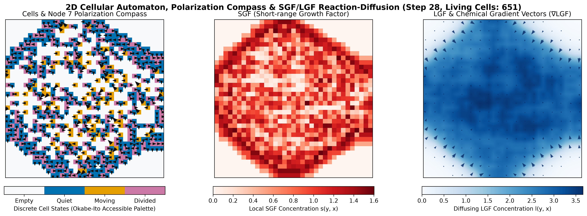

<div align="center">

# Simulation of Gene Regulatory Networks Driving Shape Homeostasis

**Computational platform for simulating, evolving, and classifying Gene Regulatory Networks (GRNs)**
**that drive self-organizing morphogenesis and shape homeostasis in multicellular systems.**

[](./CHANGELOG.md)
[](./LICENSE)
[](https://github.com/userravs/simulation-of-gene-regulatory-networks-driving-shape-homeostasis/actions/workflows/ci.yml)




</div>

---

## Overview

This platform models self-organizing multicellular collectives where shape homeostasis emerges from local cellular interactions, coupling a 2D non-toroidal cellular automaton, reaction-diffusion solvers for Short-range (SGF) and Long-range (LGF) growth factors ($O(N^2)$ Thomas ADI Crank-Nicolson), intracellular Recurrent Neural Networks (RNNs), and evolutionary optimization (Genetic Algorithms and NEAT) based on [*Gerlee et al. (2015)*](https://research.chalmers.se/en/publication/251511). See [docs/architecture.md](./docs/architecture.md) for the mathematical model, research objectives, and system diagrams.

## Quick Start

```bash
# Container (Podman or Docker — recommended on macOS & Linux)
git clone https://github.com/j0sees/Simulation-of-Gene-Regulatory-Networks-Driving-Shape-Homeostasis.git
cd Simulation-of-Gene-Regulatory-Networks-Driving-Shape-Homeostasis && ./scripts/run_container.sh

# Or run locally with Python 3.11+ and uv (http://localhost:8501)
uv sync --dev && ./scripts/run_web_app.sh
```

See [docs/getting-started.md](./docs/getting-started.md) for CLI runners, repository layout, and verification commands.

## Documentation

| Topic | Guide |
|---|---|
| **Setup, CLI & Layout** | [Getting Started & CLI](./docs/getting-started.md) |
| **Model & Architecture** | [Mathematical Model & Software Architecture](./docs/architecture.md) |
| **Interactive UI & Containers** | [Web Interface](./docs/web-interface.md) · [Docker Guide](./docs/docker.md) |
| **Project & Governance** | [Full Docs Index](./docs/README.md) · [History](./docs/history-log.md) · [Changelog](./CHANGELOG.md) · [Contributing](./CONTRIBUTING.md) · [Code of Conduct](./CODE_OF_CONDUCT.md) |

## Authors & License

- **Original 2017 Thesis Baseline (`v0.1.0`)**: **[M.Sc. José Esteban Pérez-Hidalgo](https://orion.tec.ac.cr/en/persons/jos%C3%A9-esteban-p%C3%A9rez-hidalgo/)** ([@j0sees](https://github.com/j0sees), [ORCID `0000-0001-7184-9974`](https://orcid.org/0000-0001-7184-9974), School of Physics, Costa Rica Institute of Technology — M.Sc. in Complex Adaptive Systems, University of Gothenburg), supervised by **[Ph.D. Philip Gerlee](https://research.chalmers.se/en/person/gerlee)** (University of Gothenburg & Chalmers University of Technology) — [Baseline (`6c3fae7`)](https://github.com/j0sees/Simulation-of-Gene-Regulatory-Networks-Driving-Shape-Homeostasis/tree/6c3fae7834a2ca502b1a439d7535c4adab1673f3)
- **Software Architecture, Core Engine & Lead Maintainer (`v0.2.0`–`v0.3.0`)**: **Reymer Vargas** ([@userravs](https://github.com/userravs), Independent Research Software Engineer) — Unified headless simulation engine (`core/engine.py`), $O(N^2)$ Thomas ADI reaction-diffusion solver (`LGFThomasSolver`), evolutionary diversity & NEAT upgrades, interactive phase-space/GRN inspector & vector overlays, accessible Okabe-Ito visualization & timelapse GIF exporter, Podman/Docker containerization, and CI/test suite
- **Citation**: For academic citation metadata (BibTeX / APA), see [`CITATION.cff`](./CITATION.cff) or use the **"Cite this repository"** button on GitHub.
- **License**: Released under the [MIT License](./LICENSE).
