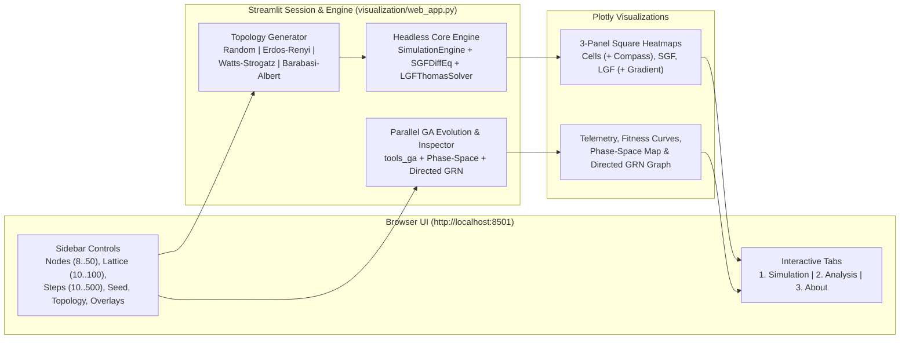
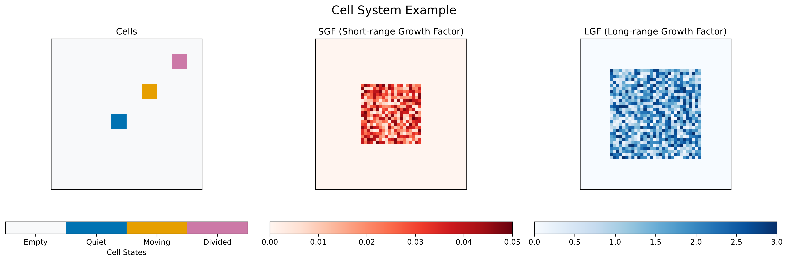

# Web Interface Documentation

## Overview

The Gene Regulatory Network simulation includes an interactive web application (`visualization/web_app.py`) built with **Streamlit** and **Plotly**. It provides browser-based parameter configuration, simulation playback controls, interactive evolutionary optimization, `(SGF, LGF)` phase-space inspection, and real-time heatmaps of cell states and chemical signaling fields.



## Quick Start

### Option 1: Container — Podman or Docker (Recommended)

```bash
# Auto-detects Podman or Docker and starts the containerized web application
./scripts/run_container.sh

# Open in your browser: http://localhost:8501
```

### Option 2: Local Execution with `uv`

```bash
# Use the local launcher script (syncs dependencies via uv automatically)
./scripts/run_web_app.sh

# Or run Streamlit directly with uv
uv sync
uv run streamlit run visualization/web_app.py --server.port 8501 --server.address 0.0.0.0
```

## Interface Features

### 1. Simulation Tab
- **Start Live / Run Full Horizon / Pause / Reset Controls**: Step interactively in real time or execute the entire horizon in a single batch pass (`SimulationEngine.run`) to scrub across every recorded step (`1..T`) via the **Timeline Scrubber**.
- **Deterministic PRNG Seed**: Toggle **Use Deterministic Seed** and set **PRNG Seed** in the sidebar to reproduce identical initial GRN topologies and morphogenesis trajectories.
- **Real-Time Parameter Adjustment**: Configure network size (`8`–`50` nodes), lattice dimensions (`10`–`100`), and time steps (`10`–`500`) from the sidebar.
- **Network Topologies**: Choose between **Random**, **Erdős-Rényi**, **Watts-Strogatz**, and **Barabási-Albert** graph architectures.
- **Color Palette**: Switch between the default **Colorblind-Safe (Okabe-Ito)** palette and the **Legacy (RGB)** palette for cellular state visualization.
- **Polarization Compass & Chemical Gradient Overlays**: Toggle **Show Cell Polarization Arrows** in the sidebar to display GRN Node 7 compass directions (`North`, `South`, `East`, `West`) over living cells on the `Cells` panel (and in recorded timelapse snapshots), or toggle **Show LGF Gradient Vectors** to overlay $\nabla \text{LGF}$ chemical gradient segments on the `LGF Concentration` panel.
- **Timelapse Recording**: Enable **Record Timelapse** and set **Snapshot Interval (steps)** in the sidebar to capture PNG frames during live or batch execution and download an animated GIF (`grn_timelapse.gif`).
- **Live Visualization & Telemetry**: Inspect 1:1 square Plotly heatmaps of cell states (`Empty`, `Quiet`, `Moving`, `Divided`), SGF concentrations, and LGF concentrations alongside per-step cell/chemical telemetry curves and the final **Shape Homeostasis Summary** ($F$, $S_{T/2}$ vs. $S_T$, and $\Delta$).



### 2. Analysis Tab
- **Evolutionary Optimization (GA)**: Configure population size, generation count, elitism, tournament size, and per-gene Gaussian mutation rate (powered by `tools_ga.initialize_population` and `tools_ga.create_next_generation`), inspect best vs. average fitness progression curves, and click **Load Best Evolved GRN into Simulation** to simulate the winning network in Tab 1.
- **Interactive `(SGF, LGF)` Phase-Space Decision Map**: Probe the active or evolved GRN across a 2D chemical concentration grid (`compute_phase_space_map`) to visualize steady-state cellular decision regions (`Die`, `Quiet`, `Moving`, `Divided`) using the colorblind-safe palette.
- **Interactive Directed GRN Graph**: Inspect excitatory ($w_{ij} > 0$) and inhibitory ($w_{ij} < 0$) regulatory connections and functional node roles (`SGF_in`, `LGF_in`, `Split`, `Move`, `Die`, `SGF_out`, `LGF_out`, `Compass`, and hidden nodes).

### 3. About Tab
- **Model Summary**: Overview of the cellular automata, chemical signaling, and recurrent neural network architecture.

## Troubleshooting

- **Port `8501` already in use**: Check active processes with `lsof -i :8501` or launch on an alternate port (`uv run streamlit run visualization/web_app.py --server.port 8502`).
- **Container import or build issues**: Rebuild cleanly via `docker-compose down && docker-compose up --build`.
- **Faster interactive rendering**: Reduce **Lattice Size** (e.g., `25`–`40`) when running long simulations in the browser.
